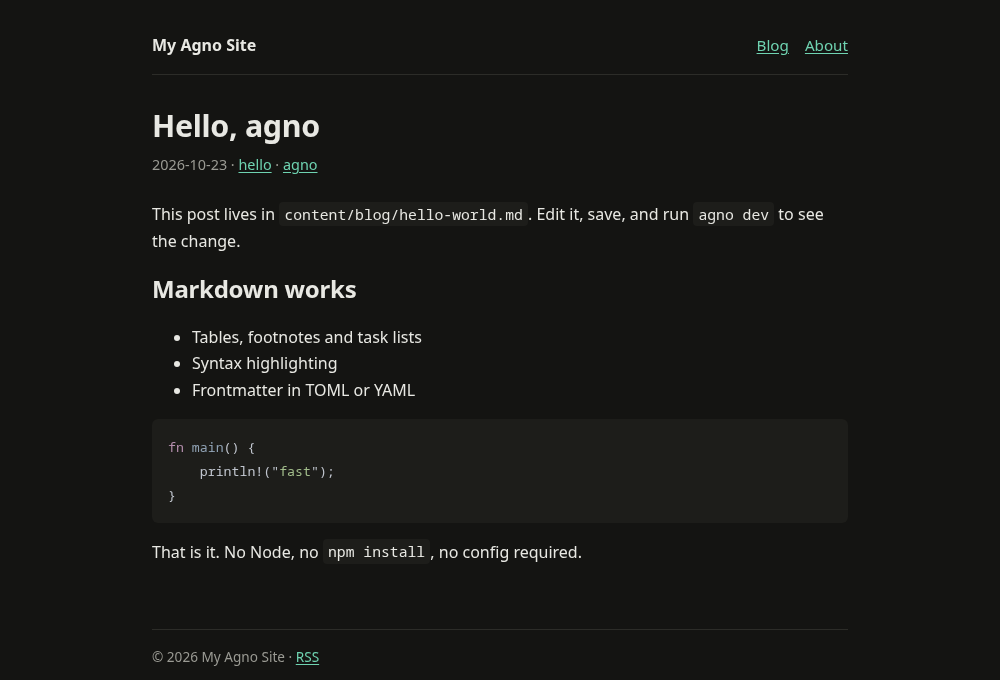
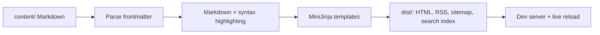

# agno

[](https://github.com/agnogad/agno/actions/workflows/ci.yml)
[](https://crates.io/crates/agno)
[](LICENSE)
[](https://www.rust-lang.org)

**A fast, content-first static site generator written in Rust.**

agno turns Markdown and Jinja-style templates into a static site from a single
4.2 MB binary — no Node.js, no bundler, and no plugin runtime. It is built for
sites where the content is the product: blogs, documentation, notes, and small
marketing pages.



<details>
<summary>Table of Contents</summary>

- [Why agno?](#why-agno)
- [Installation](#installation)
- [Quick start](#quick-start)
- [Commands](#commands)
- [Content](#content)
- [Templates](#templates)
- [Configuration](#configuration)
- [Benchmarks](#benchmarks)
- [Architecture](#architecture)
- [Design scope](#design-scope)
- [Development](#development)
- [Contributing](#contributing)
- [License](#license)

</details>

## Why agno?

- **Fast by default.** Cold builds are parallel from Markdown parsing to output
  writes: 1,000 plain posts build in about 106 ms, and 10,000 posts with code
  blocks in about 1.3 seconds on the [benchmark machine](#benchmarks).
- **Incremental by default.** A build remembers what it rendered, so a rebuild
  only touches the pages whose source, templates or site context changed:
  1,000 posts rebuild in ~33 ms, and at 10,000 posts a rebuild costs about a
  twelfth of a full build.
- **One static binary.** The release binary is 4.2 MB and has no runtime
  dependencies. No `node_modules`, no language runtime, no service to install.
- **Small, understandable surface.** A focused feature set instead of a plugin
  ecosystem, a bundler, and a JavaScript toolchain.
- **Batteries included.** Sections, pagination, tags and categories with term
  and overview pages, page bundles, drafts,
  aliases, RSS, sitemap, search index, `404.html`, a table of contents, syntax
  highlighting, a link checker, and a live-reloading dev server.
- **Comfortable authoring.** TOML or YAML frontmatter, optional templates, and
  a working site from `agno new` in seconds.

Benchmarked against Hugo, Zola, and Astro on the same corpus, agno builds
**3.3–9.3× faster than Hugo**, **1.9–14× faster than Zola** (2–6× from 1,000
posts up), and **12–161× faster than Astro** on cold builds, and 13–16× faster
than Zola on rebuilds. See [Benchmarks](#benchmarks) for numbers, methodology,
and caveats.

## Installation

### Requirements

- Rust **1.88+** (edition 2024; `time` and `plist` need 1.88)
- A C toolchain at build time (`cc`, MSVC, or Xcode command-line tools). The
  syntax highlighter bundles Oniguruma, which is C; it is compiled into the
  binary, so there is no shared library to install alongside it.

> [!NOTE]
> agno is published on [crates.io](https://crates.io/crates/agno), and every
> tagged release carries prebuilt binaries for Linux, macOS (Intel and Apple
> silicon) and Windows on the
> [releases page](https://github.com/agnogad/agno/releases). The crates.io
> version can lag a release by a few days; the binaries never do.

### Install a prebuilt binary

No Rust needed. Take the archive for your platform from the
[latest release](https://github.com/agnogad/agno/releases/latest), unpack it,
and put `agno` somewhere on your `PATH`:

```sh
# resolve the newest tag, then fetch the archive for this platform
tag=$(curl -sIL -o /dev/null -w '%{url_effective}' \
  https://github.com/agnogad/agno/releases/latest | sed 's|.*/tag/||')
curl -L "https://github.com/agnogad/agno/releases/download/$tag/agno-${tag#v}-x86_64-unknown-linux-gnu.tar.gz" \
  | tar -xz
sudo install "agno-${tag#v}-x86_64-unknown-linux-gnu/agno" /usr/local/bin/
```

The tag is resolved rather than written out because the version is part of
each archive's name: a hardcoded `/latest/download/agno-<version>-...` URL
would work until the next release and then 404.

Swap `x86_64-unknown-linux-gnu` for `aarch64-apple-darwin`,
`x86_64-apple-darwin` or `x86_64-pc-windows-msvc` (the Windows archive is a
`.zip`). The archives are built by CI on each platform, not cross-compiled
from a laptop.

#### Linux: gnu or musl

Two archives, and they differ in libc, allocator and regex engine. 3,000 posts,
twelve threads:

| | `x86_64-unknown-linux-gnu` | `x86_64-unknown-linux-musl` |
|---|---|---|
| no code | 139 ms / 38 MB | 134 ms / 118 MB |
| one code block per post | 219 ms / 41 MB | 439 ms / 155 MB |
| three code blocks per post | 443 ms / 51 MB | 942 ms / 219 MB |
| runs on | glibc 2.34+ (Ubuntu 22.04, Debian 12, RHEL 9) | any x86_64 Linux, fully static |
| allocator | system | mimalloc |
| regex engine | Oniguruma (C) | fancy-regex (Rust) |

Take **gnu** unless it will not start: on a site with code it is twice as fast
and uses a quarter of the memory. Take **musl** for an Alpine or `scratch`
container, or for anything older than glibc 2.34, where the gnu archive fails
at startup with `GLIBC_2.34 not found`.

Two separate problems forced the differences, and both are worth knowing if you
build from source:

**musl's allocator does not scale.** Not in the highlighting path, just under
contention — so the static build uses mimalloc. That is where most of its
memory goes: 118 MB against 38 MB with no code in the site.

**Oniguruma serialises on a global lock** that glibc's adaptive mutex absorbs
and musl's does not. With it, the 0.3.6 static build took 2.9 s on one thread
and 9.2 s on twelve — more cores, less throughput. The static archive therefore
builds on syntect's pure-Rust engine, where twelve threads beat one.

That fix has a price, and it is memory: fancy-regex keeps compiled state per
thread, so the static build's footprint grows with the number of code blocks
(118 → 219 MB). The 0.3.6 figure looked better partly because it was
serialised — with one thread doing the highlighting, only one thread's state was
ever live. It is also about 2× the highlighting work: 5.0 s at one thread
against 2.9 s for Oniguruma. Twelve threads more than repay that, one does not.

The rendered HTML is byte-identical either way; that was checked by diffing all
307 pages of a 300-post site built by each released binary.

Figures come from `bench/ab.py`, which interleaves the two binaries and runs a
control of the same binary twice. On this laptop that control moves by up to
15%, so read the table as ratios and treat anything smaller than that as noise
— in particular, gnu and musl are the same speed on a site with no code.

### Install from crates.io

```sh
cargo install agno
```

### Install from GitHub

```sh
cargo install --git https://github.com/agnogad/agno
```

### Build from source

```sh
git clone https://github.com/agnogad/agno.git
cd agno
cargo install --path .
```

### Verify

```sh
agno --version
# agno 0.3.7
```

## Quick start

```sh
agno new blog
cd blog
agno dev
```

You should see:

```text
Created blog

  cd blog
  agno dev

agno dev → http://localhost:1111  (2 pages, 12 ms)
```

Open <http://localhost:1111>. Edit anything under `content/`, `templates/`, or
`static/` and the browser reloads after the rebuild.

Build for production:

```sh
agno build
# Built 2 pages in 10 ms → ./dist
```

The generated site is in `dist/` and can be deployed to any static host.

## Commands

| Command | Description |
| --- | --- |
| `agno new <dir>` | Scaffold a new site with the default theme, content, and config |
| `agno build` | Build into `dist/`, reusing pages that did not change |
| `agno build --clean` | Delete `dist/` and rebuild everything |
| `agno build --drafts` | Include pages marked `draft = true` |
| `agno build --minify` | Collapse HTML whitespace and strip comments |
| `agno build --stats` | Print content, page, and feed timings |
| `agno dev` | Build, serve on port 1111, and rebuild on file changes |
| `agno dev --port 3000` | Use a different port |
| `agno dev --drafts` | Include draft pages in the dev server |
| `agno check` | Report broken internal links and missing templates |
| `agno clean` | Remove `dist/` and the local cache |

`build`, `dev`, `check`, and `clean` accept `--root <dir>` to operate on another
site directory. `new` accepts `--force` to write into a non-empty directory.

Builds are incremental. `agno build` keeps the existing `dist/` and only
re-renders pages whose source, templates, or site-wide context changed, using
the fingerprints in `.agno-cache/`. Files that no longer belong to any page are
removed through the manifest. `--clean` throws all of that away; `agno clean`
also drops the cache.

`agno check` resolves every internal Markdown link and image against the files
the build will produce, and fails with exit code 1 when something is missing.
It scans page bodies and `_index.md` landing pages, follows `#fragment`
targets to the headings they name (`#top` always resolves, as browsers scroll
to the top for it), and reports pages whose `template` does not exist and
pages without a date.

```sh
$ agno check
error: ./content/blog/hello.md:12: broken link /blog/nope/ (resolves to /blog/nope/index.html)

1 error(s) across 42 pages (318 internal links checked)
```

## Content

Frontmatter can be TOML (`+++`) or YAML (`---`):

```markdown
+++
title = "Hello, agno"
date = 2024-05-01
updated = 2024-05-02
description = "A short summary used in lists and meta tags."
tags = ["rust", "static-sites"]
categories = ["engineering"]
draft = false
weight = 10              # position in a section ordered by weight
template = "post.html"   # optional override
slug = "hello-agno"      # optional
url = "/hello/"          # optional
aliases = ["/old-hello/", "/2019/hello/"]
+++

Body in **Markdown**.
```

| Field | Purpose |
| --- | --- |
| `title` | Page title; defaults to a humanized filename |
| `date`, `updated` | Publication and modification dates; used for sorting, feeds, and sitemap |
| `description` | Meta description and list summary |
| `summary` | Explicit summary, overriding the first paragraph |
| `draft` | Excluded from builds unless `--drafts` is passed |
| `weight` | Position inside a section ordered with `sort_by = "weight"`; lower comes first |
| `tags`, `categories` | Taxonomy values; each gets a term page and a taxonomy overview |
| `template` | Template name for this page |
| `slug` | Override the generated slug |
| `url` | Override the generated URL |
| `aliases` | Extra URLs that redirect to this page with a meta refresh |

Any other frontmatter field is available to templates as
`page.extra.<name>`.

Section indexes (`content/blog/_index.md`) additionally accept `paginate_by`,
which splits the section listing into pages of that many cards, `sort_by`,
which decides the order, and `template`, which renders the listing with a
layout other than `section.html`:

```toml
+++
title = "Blog"
paginate_by = 10
sort_by = "weight"
template = "blog.html"
+++
```

Page 1 stays at `/blog/`; the rest live at `/blog/page/2/`, `/blog/page/3/`,
and so on, and are linked through `page.paginator` in `section.html`. The home
page (`content/_index.md`) takes `sort_by` and `template` too; pagination is a
section feature. `agno check` reports a `template` that does not exist.

### Ordering and navigation

`sort_by` takes one of three values, whether it sits in a section's `_index.md`
or in the home page's:

| Value | Order |
| --- | --- |
| `date` | Newest first; the default, and what a blog wants |
| `weight` | `weight` ascending, then date, then title — the documentation order |
| `title` | A–Z by title |

Anything else fails the build with the offending value and the file it came
from, so a typo cannot silently fall back to date order. Pages without a
`weight` count as `0`, and pages without a date sort after dated ones of the
same weight.

Pages in a section are also linked to their neighbours: `page.prev` and
`page.next` follow the section's own order, so a docs site walks chapter by
chapter and a blog walks newest to oldest. Both are `null` at the ends of the
section.

```html
<a rel="prev" href="{{ page.prev.url }}">{{ page.prev.title }}</a>
<a rel="next" href="{{ page.next.url }}">{{ page.next.title }}</a>
```

Each neighbour is `{ title, url, date_display }`. Changing the order, adding a
page or renaming one re-renders the pages around it on the next build, because
their navigation changed too.

A directory that directly contains pages becomes a section, at any depth, and
gets a listing at its own URL. A directory that only holds subdirectories is
not a section by itself: give it an `_index.md` if you want a landing page
there. A file named `index.md` turns its directory into a page bundle:

```text
content/blog/hello/index.md  →  /blog/hello/
```

Content files end in `.md` or `.markdown`, in any case, so `POST.MD` and
`Index.md` are picked up too.

Filenames can start with a date. `2024-05-01-hello.md` sets the date and derives
the slug automatically. URL path segments are slugified, `slug` overrides the
last segment, and tags that slugify to the same value share one tag page.

## Taxonomies

`tags` and `categories` are taxonomies: every distinct value gets a term page
listing the pages that carry it, and each taxonomy gets an overview page listing
its terms, like Hugo's `/tags/` and Zola's taxonomy pages.

```text
/tags/                     all tags, with counts
/tags/rust/                pages tagged "Rust"
/categories/               all categories
/categories/engineering/   pages in "Engineering"
```

Terms are slugified and case-folded, so `Rust` and `rust` share `/tags/rust/`.
Overview pages render with `taxonomy.html` (`page.terms[]` holds the terms);
term pages use `category.html`, then `tag.html`, then `section.html`. All of
them fall back to the embedded defaults, so nothing has to be added to a site
for the pages to exist.

## Templates

Templates use [MiniJinja](https://docs.rs/minijinja) and live in `templates/`.
Files in `templates/` override the embedded defaults; missing templates fall
back to them, so a site still builds without a `templates/` directory.

| Variable | Contents |
| --- | --- |
| `site.title`, `site.description`, `site.base_url`, `site.language`, `site.author`, `site.menu`, `site.year`, `site.post_count` | Site metadata |
| `site.tags[].name`, `.url`, `.count`, `.latest_title`, `.latest_url` | Tags with post counts and the newest tagged post |
| `site.categories[].name`, `.url`, `.count`, `.latest_title`, `.latest_url` | The same shape for categories |
| `site.sections[].title`, `.url`, `.count` | Top-level sections, for building navigation |
| `page.title`, `page.url`, `page.date`, `page.date_display`, `page.datetime`, `page.reading_minutes`, `page.description`, `page.content`, `page.tags`, `page.categories`, `page.slug`, `page.section`, `page.extra` | Current page or list page |
| `page.updated`, `page.updated_display` | The `updated` frontmatter date, if set |
| `page.words`, `page.toc`, `page.toc_html` | Word count, heading tree (`level`, `id`, `title`, `children`), and the same tree rendered as nested `<ul>` |
| `page.paginator` | Pagination state on section pages: `current`, `total`, `page_size`, `item_count`, `prev_url`, `next_url`, `first_url`, `last_url`, `links[]` |
| `page.prev`, `page.next` | Neighbouring pages in the section's order: `title`, `url`, `date_display`; `null` at the ends |
| `page.terms[]` | Taxonomy overview pages only: `name`, `url`, `count` for each term |
| `pages[].title`, `.url`, `.date`, `.date_display`, `.datetime`, `.reading_minutes`, `.summary`, `.tags`, `.section` | Page cards in list templates |

`page.toc` is empty when a page has fewer than two headings. Every heading gets
a slugified `id`, so `#some-heading` links work out of the box; duplicate
headings are disambiguated with a numeric suffix.

The default templates are `base.html`, `page.html`, `section.html`,
`index.html`, `taxonomy.html`, and `404.html`. Add `tag.html` or `category.html`
to use a dedicated layout for those term pages. Filters include `slugify`,
`starts_with`, `safe`, and the MiniJinja built-ins.

Autoescaping is on for HTML, and it escapes only the characters that are
special in text or in a quoted attribute, so a path stays readable:

```html
<a href="{{ page.url }}">{{ page.title }}</a>
```

`page.content` is already rendered HTML, so it still needs `|safe`.

```html


  <h1>{{ page.title }}</h1>
  <div class="content">{{ page.content|safe }}</div>

```

## Configuration

`agno.toml` is optional; every key has a default.

```toml
title = "My Site"
description = ""
base_url = "https://example.com"
language = "en"
author = "Your Name"

content_dir = "content"
templates_dir = "templates"
static_dir = "static"
output_dir = "dist"

highlight = true
rss_items = 20
search_index = false

[[menu]]
title = "Blog"
url = "/blog/"

[[menu]]
title = "About"
url = "/about/"
```

Set `search_index = true` to emit `search-index.json` for client-side search.
`page.date_display` follows `language` for Turkish and English month names.
`base_url` must be an absolute `http(s)` URL: canonical links, the sitemap and
the feed are built from it, so a bare host name would make every one of them
relative.
`output_dir` must stay inside the site root and must not overlap `content_dir`,
`templates_dir`, or `static_dir`; agno rejects unsafe values instead of deleting
your inputs.

## Benchmarks

Cold-build medians on an Intel i5-13420H (12 threads), CachyOS, Linux 7.2.
The output directory is removed before every timed run and process startup is
included. `code` adds one syntax-highlighted code block per post; `heavy` adds
three code blocks, a table, and a footnote.

| Scenario | agno | Hugo | Zola | Astro |
| --- | ---: | ---: | ---: | ---: |
| 100 posts, plain | **22.9 ms** | 212.2 ms | 191.7 ms | 3,685 ms |
| 1,000 posts, plain | **106.4 ms** | 501.3 ms | 250.7 ms | 5,546 ms |
| 1,000 posts, code | **136.0 ms** | 516.3 ms | 437.8 ms | 4,787 ms |
| 1,000 posts, heavy | **207.7 ms** | 1,892.6 ms | 1,080.0 ms | 5,407 ms |
| 3,000 posts, heavy | **636.9 ms** | 5,757.0 ms | 2,248.4 ms | 7,425 ms |
| 10,000 posts, code | **1,308 ms** | 4,006 ms | 3,236 ms | — |

| Other situations | agno | Hugo | Zola | Astro |
| --- | ---: | ---: | ---: | ---: |
| Single-edit rebuild, 1,000 posts | **32.8 ms** | 691.4 ms | 485.7 ms | — |
| 2-page site, cold build | **12.1 ms** | 102.5 ms | 113.5 ms | 2,497 ms |
| CLI startup | **1.9 ms** | 79.1 ms | 13.4 ms | 114.7 ms |
| Peak RSS, 1,000 posts/code | **21.7 MB** | 168.1 MB | 76.3 MB | 613.2 MB |
| Peak RSS, 3,000 posts/heavy | **51.2 MB** | 558.8 MB | 170.7 MB | 688.3 MB |
| Install footprint | **4.3 MB binary** | 95.1 MB binary | 50.8 MB binary | 121 MB `node_modules` |

At 10,000 posts agno sustains about **7,642 pages/s**, compared with 2,496
pages/s for Hugo and 3,090 for Zola. The full matrix, raw samples, and
reproduction steps are in [`bench/REPORT.md`](bench/REPORT.md) and
[`bench/README.md`](bench/README.md).

Astro is missing from the rebuild row on purpose: its rebuild empties the output
directory before rendering, and that deletion dominates the run on this
filesystem (36 s against a 4.8 s cold build at 1,000 posts), so the number would
measure the disk instead of the generator.

> **Report versions:** agno 0.3.2, Hugo 0.168.0, Zola 0.23.6, Astro 7.4.2.
> Rerun [`bench/suite.py`](bench/suite.py) to measure your own machine.

### Zola

Zola is the closest Rust neighbour, so it also gets a head-to-head run: the
same corpus built twice, with equivalent templates, tag pages, a feed, a
sitemap and syntax highlighting, and the two generators alternating inside every
scenario so a load spike hits both. Medians of 7 runs on the machine above —
a separate interleaved run, so it differs from the matrix by a few percent —
agno 0.3.2 against Zola 0.23.6:

| Posts | Profile | Cold build | | Rebuild | |
| ---: | --- | ---: | --- | ---: | --- |
| 1,000 | plain | **100 ms** / 233 ms | 2.3× | **21 ms** / 353 ms | 17× |
| 1,000 | code | **124 ms** / 433 ms | 3.5× | **30 ms** / 546 ms | 18× |
| 1,000 | heavy | **227 ms** / 1,285 ms | 5.7× | **32 ms** / 1,318 ms | 41× |
| 3,000 | heavy | **608 ms** / 2,389 ms | 3.9× | **85 ms** / 2,764 ms | 32× |
| 10,000 | code | **1,304 ms** / 3,405 ms | 2.6× | **187 ms** / 4,990 ms | 27× |

Zola has no incremental mode: `zola build` deletes the output directory and
renders everything, so its rebuild costs as much as a cold build. agno keeps
fingerprints per page and rewrites only what changed. Peak RSS at 1,000
posts/code is 21 MB against 76 MB, and the binary is 4.3 MB against 50.8 MB.

Method, single-edit numbers, and caveats: [`bench/ZOLA.md`](bench/ZOLA.md).
Reproduce with:

```sh
python3 bench/zola_compare.py --count 1000 --profile code --runs 5
```

### Search index cost (agno 0.2.0)

The search index is optional and off by default. On the same corpus, toggling
`search_index` costs:

| Posts | `lists+feeds` off | on | Delta | Output off | on | `search-index.json` |
| ---: | ---: | ---: | ---: | ---: | ---: | ---: |
| 1,000 | 9.0 ms | 9.0 ms | **+0.0 ms** | 3.50 MB | 3.87 MB | 0.37 MB |
| 10,000 | 84.0 ms | 110.0 ms | **+26.0 ms** | 34.90 MB | 38.61 MB | 3.71 MB |

`lists+feeds` is the build phase that writes the index, so its delta isolates
the index from content loading and page rendering. Whole-build wall-clock
deltas were within run-to-run noise. Raw samples and method:
[`bench/SEARCH_INDEX.md`](bench/SEARCH_INDEX.md).

### Incremental rebuilds (agno 0.3.0)

Every build writes a fingerprint per page into `.agno-cache/fingerprints.bin`.
A rebuild re-renders a page only when its source, the templates, or the
site-wide context changed, so a no-op rebuild is mostly a directory walk and a
manifest diff.

| Posts | Cold (`--clean`) | No-op rebuild | One post edited |
| ---: | ---: | ---: | ---: |
| 1,000 | 60 ms | **23 ms** | **23 ms** |
| 10,000 | 2.9 s | **234 ms** | **224 ms** |

Wall-clock on a busy host swings by 30% between runs, so the table below
compares CPU time (`user` + `sys`), which does not. It also shows what 0.3.0
changed for full rebuilds, which cannot skip any work:

| Posts | Cold build, 0.2.0 → 0.3.0 | Rebuild, 0.2.0 → 0.3.0 |
| ---: | ---: | ---: |
| 1,000 | 206 → 235 ms (+14%) | 145 → 78 ms (**1.9× less**) |
| 10,000 | 8.8 → 10.0 s (+14%) | 4.8 → 0.74 s (**6.5× less**) |

The 14% cold-build cost is the table of contents, word counts, and fingerprint
bookkeeping that every page now pays for. Rebuilds are 2–6.5× cheaper because
they skip that work entirely: at 10,000 posts a rebuild costs about **1/12** of
a cold build.

Each cell is the fastest of 4–9 alternating runs of the 0.2.0 and 0.3.0
binaries against the same corpus. The cold column is dominated by the
filesystem rather than by agno: on the benchmark host's Btrfs volume
(`compress=zstd`), deleting the previous 10,000-file output tree takes 1.2 s and
writing the new one about another second, which is why the same build finishes
in about one second on the ext4 machine used for the older numbers above.

Reproduce the rebuild numbers with:

```sh
python3 bench/incremental.py --count 10000 --runs 5
```

The old `agno build --no-clean` path, which re-rendered every page but skipped
deleting the output tree, is gone: incremental builds are now the default and
`--clean` is the opt-in full rebuild.

### Section landing pages

A site with many sections — documentation, notes, a course — used to pay for
every `_index.md` on every build: the Markdown body was parsed and highlighted
while content was loaded, even when the listing was unchanged and would not be
written. Section bodies are now rendered on demand, once per section, inside the
parallel list phase.

Corpus: 300 sections, each with a `_index.md` containing two code blocks and
five pages (1,801 pages). Medians of 5 runs, alternating the 0.3.2 and branch
binaries on the same corpus:

| Scenario | 0.3.2 | branch | |
| --- | ---: | ---: | --- |
| Cold build (`--clean`) | 379 ms | **330 ms** | 1.2× faster |
| No-op rebuild | 118 ms | **31 ms** | 3.8× faster |
| Single-edit rebuild | 116 ms | **40 ms** | 2.9× faster |

The cold build is mostly deleting and rewriting 1,800 files on Btrfs, which is
why it gains less than the rebuilds: the Markdown work that moved out of the
content phase is a smaller share of it. A blog-shaped corpus without section
bodies is unaffected — 3,000 posts rebuild in 40 ms either way, because there is
no section Markdown to skip.

```sh
python3 bench/sections.py --sections 300 --per-section 5 --runs 7
```

> **Fairness note:** the Astro fixture renders Markdown pages only and does not
> include syntax highlighting, taxonomies, RSS, or a sitemap. Its timings are
> optimistic. agno and Hugo both perform real syntax highlighting (syntect /
> Oniguruma and Chroma, respectively). Numbers vary with hardware, filesystem,
> and corpus; run the suite on your own machine before making decisions.

## Architecture

agno keeps the pipeline intentionally small:



- [`src/content.rs`](src/content.rs) discovers Markdown files, parses
  frontmatter, and derives URLs, dates, and sections.
- [`src/markdown.rs`](src/markdown.rs) renders CommonMark/GFM with
  `pulldown-cmark`, builds the table of contents, and highlights fenced code
  with `syntect`.
- [`src/render.rs`](src/render.rs) renders MiniJinja templates with the embedded
  theme as a fallback.
- [`src/site.rs`](src/site.rs) runs the parallel build, writes pages and feeds,
  and cleans the output directory.
- [`src/cache.rs`](src/cache.rs) stores per-page fingerprints so unchanged pages
  can be skipped.
- [`src/minify.rs`](src/minify.rs) is the conservative HTML minifier behind
  `--minify`.
- [`src/check.rs`](src/check.rs) resolves internal links for `agno check`.
- [`src/serve.rs`](src/serve.rs) serves `dist/` with `tiny_http` and rebuilds on
  filesystem changes.
- [`src/scaffold.rs`](src/scaffold.rs) creates a working starter site.

Builds use Rayon for parallel parsing, rendering, output writing, and cleanup.

## Design scope

agno is deliberately a **content-first** static site generator. It does not aim
to replace application frameworks:

- no JavaScript islands or component framework
- no bundler or asset pipeline
- no plugin system
- no image optimization pipeline
- no i18n framework or theme marketplace

Static `<script>` tags, plain CSS, and the `static/` directory are the extension
points. Keeping that surface small is what keeps the binary portable and the
build fast.

## Development

```sh
cargo fmt --check
cargo clippy --all-targets -- -D warnings
cargo test
```

The benchmark matrix compares agno with Hugo, Astro and Zola:

```sh
python3 bench/suite.py
```

See [`bench/README.md`](bench/README.md) for prerequisites, fixtures, scenarios,
and environment variables.

## Contributing

Issues and pull requests are welcome. Keep changes focused, add a test when
behavior changes, and run the checks in [Development](#development).

[Open an issue](https://github.com/agnogad/agno/issues) ·
[Submit a pull request](https://github.com/agnogad/agno/pulls)

## License

[MIT](LICENSE) © 2026 agno contributors
